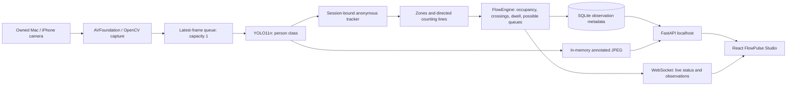

# FlowPulse AI — Current architecture

FlowPulse is a **single-machine, operator-controlled, people-flow analytics application**. Its measurement pipeline is YOLO person detection, session-only spatial tracking, image-plane zone metrics and reviewable temporal observations. It is designed for a solo portfolio demonstration, not safety-critical automation or identifying individuals.

## Entry points

- `backend/app/main.py` — localhost REST/WebSocket API; consent checks, source lifecycle and event/domain filters.
- `backend/app/pipeline.py` — exclusive capture/inference workers, bounded frame queue, model/track/flow integration, source reset.
- `backend/app/local_camera.py` and `backend/app/avfoundation.py` — macOS device discovery and isolated camera capture; no external phone app needed.
- `backend/app/vision.py` — pretrained YOLO11n person-only inference for real sources.
- `backend/app/tracking.py` — in-session spatial association; **not** person identification or a state-of-the-art multi-object tracking benchmark.
- `backend/app/flow.py` — camera-plane polygon membership, directed line crossings, mature-track dwell, and conservative queue hypotheses.
- `backend/app/storage.py` — WAL-enabled SQLite persistence, review status, people/legacy domain filtering.
- `frontend/src/App.tsx` — camera-first studio, live preview, events, diagnostics and privacy disclosures.
- `frontend/src/CameraSetup.tsx` — device list, consent gating, preview-first workflow.
- `frontend/src/ZoneEditor.tsx` — authenticated-to-current-local-source configuration through the loopback API.
- `frontend/src/useLive.ts` — versioned WebSocket updates plus defensive polling after reconnection/source changes.

## Session state and capture rules

Ordinary `make dev` forces `ROADPULSE_AUTOSTART=false`, so no old synthetic demo or camera activates without a local selection. A camera-selection action records analysis/redisplay authorization and opens only the chosen device. Preview uses real inference but **disables temporal observations**. The operator then starts monitoring after changing frames have been verified. Pause releases capture, retaining a labeled still; Stop releases capture and removes the last frame. Track and event baselines reset across source changes and discontinuities.

All camera frame processing happens locally. The backend keeps an in-memory latest frame and a single active worker. Old queued frames are superseded rather than letting the dashboard accumulate latency. Camera discovery may return changing numeric device indices; the UI sends the stable AVFoundation device ID when available and requires new consent when selection changes.

## Measurement contracts

- **People visible:** current per-image YOLO person detections. Not building occupancy.
- **Zone occupancy:** temporary tracks whose bottom-center anchors are in a user-defined image polygon, excluding ignore zones. Not certified human headcount or physical density.
- **Entries / exits:** counts of mature tracks crossing a directed 2-point segment with hysteresis and cooldown. Reset for a new session or discontinuity; tracking errors can cause missed or duplicate crossings.
- **Extended dwell:** a candidate sustained within a monitoring polygon past the configured duration. Does not infer intention.
- **Possible queue buildup:** sustained occupancy with a sufficient low-motion fraction. It is *not evidence of a line, waiting behavior, or person-specific intent*.

The rule engine needs continuous fresh input and an authorized non-preview session. Snapshots, stale/frozen frames and synthetic vehicle fixtures never prove human flow. Model and tracker quality depend on camera perspective, lighting, occlusion, FPS and scene stability. The included tests validate software invariants, not field accuracy.

## Persistence and API boundaries

SQLite stores event metadata, review labels and normalized geometry. It does not store raw footage by default. Evidence, when enabled separately, is a schematic derived from detections, not original video. The WebSocket communicates operational telemetry; the browser retrieves processed JPEG frames from the local API. The service is designed for **one machine / one backend worker**; no multi-tenant authentication is provided. Do not expose it to a public network.

`/api/events?domain=people` and `/api/events/export?domain=people` isolate the two people-flow observation kinds from archived vehicle-fixture events. Historical records remain intact, and legacy filters are opt-in. `ROADPULSE_` environment settings and the Python `app` package namespace are deliberately retained to avoid breaking existing Mac installations.

## Quality gates

1. `make lint` — Python, TypeScript and ESLint static checks.
2. `make test` — regression tests for consent, lifecycle, events, zones and flow rules.
3. `make build` — production dashboard bundle.
4. `make verify-people` — actual consecutive live frame check on a consented Mac camera.
5. Controlled trials documented in `docs/FLOWPULSE_EVALUATION.md` — accuracy, failure modes and human reviews.

The original RoadPulse traffic engineering architecture remains in [`docs/legacy/ROADPULSE_ARCHITECTURE.md`](legacy/ROADPULSE_ARCHITECTURE.md) solely for project provenance and legacy adapter maintenance.
