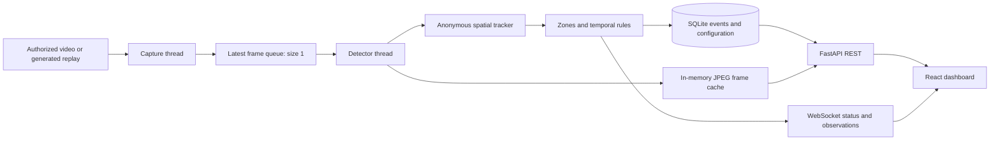

# Architecture

Lifecycle controls use explicit POST /api/system/pause, resume and stop routes.
Pause closes capture/inference and retains one labeled still frame; Stop also
clears pixels and frame identity. Resume reopens the same source and starts a new
tracker session/baseline. OFFLINE is acknowledged only after capture release;
an unreaped process stays STOPPING with an actionable error. Source `mode`
describes input capability (LIVE/REPLAY/SNAPSHOT), while `state` describes its
current lifecycle. Do not infer pause/stop from mode.

Preview uses the existing real capture/YOLO worker with temporal rules disabled.
The operator confirms Start road monitoring after seeing the selected device.
Changing-frame verification is reset on each connection; no active LIVE badge
is shown before at least two different frames arrive. Status control revisions
reject messages captured before a pause/stop/switch acknowledgement. The source
selector is a single workflow; the active-source display is read-only.

Fintraffic availability is tri-state. Missing summary flags require detailed
metadata. Detailed collectionStatus must be GATHERING; explicit fault states are
rejected. Missing state remains unknown, not OK, and a decoded official JPEG
with valid fresh provider/image-update time is mandatory before yielding pixels.
Alternative discovery checks a bounded subset only on operator request and
never automatically substitutes a camera.

Owned-camera extension: OpenCV AVFoundation capture runs in a disposable spawned
process with a one-frame queue and an eight-second bounded parent wait. Shutdown
signals, then terminates/kills a blocked capture process within bounded joins.
The parent capture thread forwards genuine decoded pixels into the existing
one-frame inference queue; skipped capture sequences and inference supersessions
are counted. No synthetic fallback exists on failure. Device permission is
explicit, process-local consent or a private server configuration opt-in.

Source capabilities explicitly describe continuous versus snapshot input,
tracking/temporal support, authorization and known provider capture timestamps.
Receipt time remains labeled as receipt time for local/stream video. Runtime
status adds processed resolution and per-session track IDs/normalized boxes and
image-plane movement. Tracking remains the existing class-aware greedy spatial
matcher with velocity prediction and TTL, not ByteTrack. Road accuracy is not
established by mocked timing/association tests.

Capture generations invalidate in-flight inference on disconnection. Retired
frames cannot publish pixels, detections or events into a recovered session.
Frame IDs, JPEG headers and per-image detections remain atomically associated.
The frontend commits activation responses and keeps polling useful even if an
open WebSocket stops delivering status, while rejecting stale source responses.

RoadPulse runs two localhost services: a React/Vite dashboard at port 5173 and a FastAPI API at port 8000. The frontend proxies REST and WebSocket traffic to the backend. There is no account system, hosted inference, external telemetry, or paid API.

## Capture and inference

One active source uses one capture thread and one inference thread. Capture uses OpenCV's FFmpeg decoder, with 5-second open/read timeouts, explicit release, and capped exponential reconnect delays. Old queued frames are superseded instead of accumulating latency. File replay is paced to its encoded frame rate. The original generated replay uses a 960×540 frame and no disk footage.

The default synthetic color detector reads the generated image pixels, then uses the same tracker/rules/storage path as the live detector. It is deliberately labeled a fixture detector. The optional Ultralytics adapter selects the COCO car, motorcycle, bus and truck classes and normalizes boxes. Model loading is lazy, only when a configured source is activated. Missing dependencies/weights produce an actionable offline state.

The in-repository tracker uses class-aware nearest-anchor association with velocity prediction, a bounded history, and a 2.5-second missing-track expiry. It is an intentionally modest alternative, **not ByteTrack**. IDs receive a random session prefix and reset on activation, replay boundaries, sustained identical frames, large frame changes or continuity gaps. Close/crossing vehicles and heavy occlusion can cause identity switches; do not infer identity.

## Rules

Shapely validates simple polygons and computes clipped box unions, avoiding double-counting overlapping box area. Bottom-center anchors determine lane membership. Ignore zones take priority. Camera sources other than the generated demo start without lanes and cannot produce temporal observations until an operator saves zones.

A stopped-vehicle candidate requires a mature, observed track below the normalized diagonal-motion threshold. A general-stop heuristic suppresses individual alerts when at least three mature tracks are mostly stationary. Congestion candidates require a warm moving-traffic baseline, increased occupancy, at least three tracks, reduced motion and sustained duration. The reference freezes during a queue candidate/active observation. Lower occupancy/motion clear thresholds provide hysteresis.

Candidates remain in memory; active and resolved observations are persisted. Cooldown begins on resolution. Review labels are separate from lifecycle state and survive worker updates/restarts. Rule/configuration/source discontinuities resolve outstanding active observations and clear temporal baselines. Previously active database observations are resolved at process startup.

## Time, metrics and delivery

UTC ISO 8601 wall-clock timestamps are stored and rendered in browser local time. Monotonic capture times drive duration and displacement. No reliable upstream timestamps are assumed; the API returns `source_timestamp: null`. Capture age and processing age are measured locally. Detector p50/p95 exclude capture/decode, tracking and network delay. Rolling FPS uses at most 20 seconds of actual timestamps. History contains at most 3,600 measured samples and resets with activation; chart history is not persisted across process restart.

REST polling every five seconds repairs disconnected WebSocket updates. WebSocket events have `version`, discriminating `type`, and sequence numbers for observations. Clients deduplicate by event ID and refresh after reconnect. Browser frames are fetched from the latest in-memory JPEG at status updates; this can display fewer frames than inference processes. MJPEG is also available. No upstream URL is returned.

SQLite uses WAL, parameterized queries, short transactions and a per-process lock. This application is designed for a single backend process; do not start multiple Uvicorn workers against one capture pipeline.

## Security boundary

This is a localhost tool. Source URLs and file paths can only be configured in trusted server environment settings. No endpoint accepts arbitrary source URLs or filesystem paths. A source hostname must be allowlisted; private destinations require explicit local opt-in. This is **not** a hardened public media proxy: FFmpeg follows provider playlists/redirects and trusted source configuration is required. Do not publish the service or accept untrusted configuration.

HTTP Host and Origin checks protect the local interface; the WebSocket also checks Origin. CORS is restricted to the configured dashboard origins. Provider source/terms links drop credentials, query strings and fragments. Decoder logs are suppressed; operational errors are generic. Permission evidence, not just public availability, must justify analysis and browser display.

## Digitraffic provider extension

`app/digitraffic.py` implements official-host/path validation, pooled HTTP with gzip/conditional GET, bounded cache/byte limits, rate limiting and backoff, GeoJSON/preset parsing, selected-image decoding and separate TMS parsing. The HTTP dependency is part of backend runtime requirements. Metadata routes offload requests to worker threads. No provider request runs directly on the FastAPI event loop.

The source selector resolves a station/preset before activation. `DigitrafficSnapshot` uses the same single capture/inference pipeline with `SNAPSHOT` mode. It emits only changed images; frame packets carry the selected image's provider timestamp along with its pixels. Snapshot detections bypass the tracker and temporal rules; annotations and counts use those same detections. The displayed source timestamp never advances on a 304 or identical image. Current raw/annotated JPEGs remain in memory. A model instance is retained for subsequent real-source activations and is not shared by concurrent inference workers.

Provider selection uses stable preset IDs for per-camera zone/configuration storage. Synthetic event feeds are scoped away from real-camera Overview; archive rows still identify their camera and synthetic origin. Continuous-video occupancy charts are hidden for snapshots. TMS observations come from an independently selected station and retain provider units/timestamps; they are not written as YOLO-derived events or automatically joined by geography.

Digitraffic rights are scoped to its official CC BY 4.0 adapter and attribution. Arbitrary configured sources retain the original permission gate. Native FFmpeg playlist/redirect limitations still apply to those separately configured video sources. The current HTTP implementation blocks redirects for Digitraffic, validates public initial host resolution and rejects unexpected MIME/schema/size responses. DNS resolution uses the operating system resolver; this is a trusted localhost application, not an untrusted public media proxy.

## Camera/frame identity and selection transitions

Known-source activation now stops the previous worker before source preflight, clears old pixels and measurements, and keeps a failed requested source offline. The React hook tracks source transition epochs and ignores late status from a retired source. Snapshot page layouts share the actual backend selection; the event archive defaults to that camera.

A processed bundle (raw/annotated JPEG, detections, provider timestamp/hash, input-frame hash and per-image inference duration) is committed together only after JPEG encoding succeeds. Frame endpoints can require camera/frame IDs and expose identity headers. Images in the view and zone editor are source-scoped, so a source race produces 409/waiting rather than old demo pixels under real labels.

The default real probe uses bounded dynamic metadata discovery. The positive probe separately records whether actual vehicle detections occurred. The opt-in real browser test compares the original provider JPEG hash with the backend inference source and rendered frame IDs, then checks page changes/fullscreen/responsiveness. Network-blocked or mock checks do not fulfill that gate.
